


  
  
  
  

<!-- 너굴폰 메뉴 -->

  

 

<!-- ───────────────────────── 주민 소개 ───────────────────────── -->

  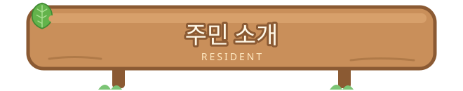
    
  
    
  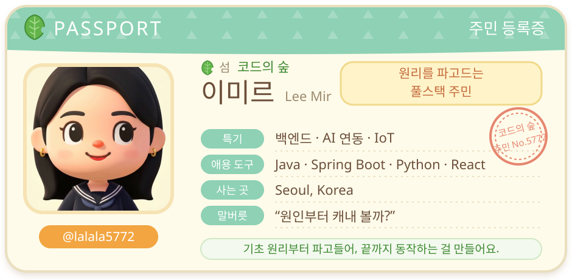

 

> 🍃 **이 섬에서 지내는 방식**
> - 표준 라이브러리 함수도 직접 다시 만들어 보면서 **원리부터** 이해해요. ([libft](https://github.com/lalala5772/libft), [get_next_line](https://github.com/lalala5772/get_next_line))
> - 센서 → 서버 → 클라우드 → 대시보드처럼 **처음부터 끝까지 이어지는** 시스템을 좋아해요.
> - 새로 배운 건 저장소마다 README로 꼼꼼히 정리해서 섬의 공유 자산으로 남겨요. 📝

 

<!-- ───────────────────────── 기술 스택 ───────────────────────── -->

  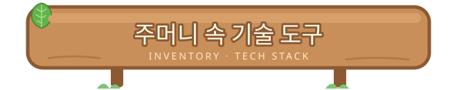
    

🎒 저장소 23곳을 둘러보며 실제로 써 본 도구들을 주머니에 담았어요

  

 

 

<table align="center">
  <tr>
    <td align="center" width="150"><b>🗣️ 언어</b> Language</td>
    <td>
      
      
      
      
      
      
      
      
    </td>
  </tr>
  <tr>
    <td align="center"><b>🏡 백엔드</b> 집 짓기</td>
    <td>
      
      
      
      
      
      
      
      
      
    </td>
  </tr>
  <tr>
    <td align="center"><b>🎨 프론트엔드</b> 집 꾸미기</td>
    <td>
      
      
      
      
      
      
      
    </td>
  </tr>
  <tr>
    <td align="center"><b>📦 데이터베이스</b> 창고</td>
    <td>
      
      
      
      
      
      
      
    </td>
  </tr>
  <tr>
    <td align="center"><b>🤖 AI · 비전</b> 똑똑한 도구</td>
    <td>
      
      
      
      
      
    </td>
  </tr>
  <tr>
    <td align="center"><b>🌱 IoT</b> 텃밭 가꾸기</td>
    <td>
      
      
      
      
    </td>
  </tr>
  <tr>
    <td align="center"><b>☁️ 클라우드 · 배포</b> 비행장</td>
    <td>
      
      
      
      
    </td>
  </tr>
  <tr>
    <td align="center"><b>💰 Web3 · 모바일</b> 벨 교환소</td>
    <td>
      
      
      
      
    </td>
  </tr>
  <tr>
    <td align="center"><b>🧰 공구함</b> Tools</td>
    <td>
      
      
      
      
      
      
      
    </td>
  </tr>
</table>

 

<!-- ───────────────────────── 프로젝트 ───────────────────────── -->

  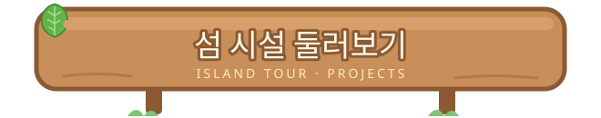
   
  🗺️ 섬 지도를 펼쳐 보세요! 시설마다 제가 만든 저장소가 살고 있어요

 

### 🏪 너굴 상점 — 웹 서비스 & 업무 자동화

<table>
  <tr>
    <td width="50%" valign="top">
      <h4>📑 <a href="https://github.com/lalala5772/g2b-OA-system">g2b-OA-system</a></h4>
      나라장터 공고를 매일 스캔해서 <b>AI가 적격 여부를 판단</b>하고, 참가신청서 빈칸을 회사 자료로 채워 주는 업무 자동화 플랫폼
      <ul>
        <li>Spring Boot(인증·도메인) ↔ FastAPI(문서 파싱·AI) ↔ React 3계층 구조</li>
        <li>Claude API로 공고 요약·필드 자동 추출·증빙 서류 매칭</li>
        <li>날짜 범위 페이지를 <b>병렬 조회</b> 후 키워드 매칭, <code>@Scheduled</code> 자동 스캔</li>
      </ul>
      
      
      
      
      
    </td>
    <td width="50%" valign="top">
      <h4>🗳️ <a href="https://github.com/lalala5772/mock-election-backend">선견지표</a> (<a href="https://github.com/lalala5772/mock-election-frontend">FE</a>) · 팀</h4>
      실시간 모의투표·후보 정책 비교·투표소 지도·실시간 채팅을 갖춘 <b>교육용 선거 정보 플랫폼</b> 🏆
      <ul>
        <li>Spring Boot REST API + JWT · Google OAuth</li>
        <li>STOMP/SockJS 채팅과 비속어 필터링</li>
        <li>JPA·MyBatis 혼용, MongoDB·Redis까지 다양한 저장소 사용</li>
      </ul>
      
      
      
      
      
    </td>
  </tr>
  <tr>
    <td width="50%" valign="top">
      <h4>🏢 <a href="https://github.com/lalala5772/groupware">groupware</a> · 팀</h4>
      메일·실시간 메신저·게시판·<b>화상회의</b>·전자결재·출결을 한곳에 모은 협업 그룹웨어
      <ul>
        <li>WebSocket/STOMP 메신저, WebRTC 화상회의</li>
        <li>Quartz 스케줄러, Spring Mail, AWS S3 파일 저장</li>
      </ul>
      
      
      
      
      
    </td>
    <td width="50%" valign="top">
      <h4>🗺️ <a href="https://github.com/lalala5772/london-urban-insights">london-urban-insights</a> · 팀</h4>
      Google Maps 위에 런던 LSOA별 숙소·치안·인구·녹지 <b>주제도</b>를 그리고 Airbnb 숙소를 조건 검색
      <ul>
        <li>Spring Boot 4 + Hibernate Spatial로 PostGIS 공간 쿼리</li>
        <li>Docker Compose + GitHub Actions로 GCP VM 자동 배포</li>
      </ul>
      
      
      
      
      
    </td>
  </tr>
</table>

### 🌱 텃밭 — 토양 센서 IoT 파이프라인

> 땅속 센서에서 웹 대시보드까지, 데이터가 지나가는 길을 저장소 4곳에 걸쳐 직접 만들었어요.

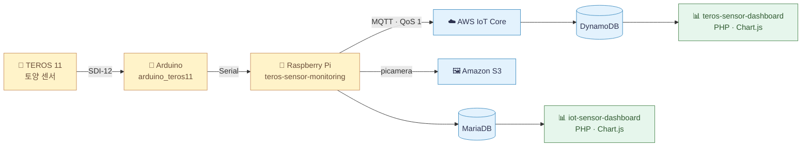

  
  
  
  

### ✈️ 도도 비행장 — AI & 컴퓨터 비전

<table>
  <tr>
    <td width="50%" valign="top">
      <h4>🚁 <a href="https://github.com/lalala5772/ai-drone">ai-drone</a></h4>
      얼굴·손가락 좌표로 <b>드론을 조종</b>하는 실습 코드 — 고등학생 AI 드론 수업 교재로 사용
      <ul>
        <li>Haar Cascade 얼굴 검출 → MediaPipe 얼굴/손 랜드마크</li>
        <li>좌표 기반 방향 제어 & 추적 로직 개선</li>
      </ul>
      
      
      
    </td>
    <td width="50%" valign="top">
      <h4>📍 <a href="https://github.com/lalala5772/semantic-address-search-with-dpr">semantic-address-search</a> · 팀</h4>
      "도서관 근처 흡연구역 어디야?" 같은 자연어 질문에 <b>캠퍼스 POI 좌표</b>를 찾아 지도에 표시
      <ul>
        <li>KLUE-BERT 기반 SBERT로 질의–장소 설명 유사도 검색</li>
        <li>Flask API + 카카오맵 웹 클라이언트 (토끼 이스터에그 🐰)</li>
      </ul>
      
      
      
    </td>
  </tr>
</table>

### 🐱 고양이 마을 & 💰 벨 교환소

<table>
  <tr>
    <td width="50%" valign="top">
      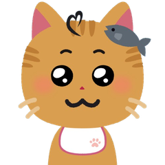
      <h4>🗓️ <a href="https://github.com/lalala5772/sCatdule">sCatdule</a> · 팀</h4>
      일정을 해낼수록 <b>나만의 고양이가 자라는</b> 게이미피케이션 일정 관리 앱
      <ul>
        <li>RecyclerView 스와이프 · CardView 기반 일정 UI</li>
      </ul>
      
      
    </td>
    <td width="50%" valign="top">
      <h4>⛄ <a href="https://github.com/lalala5772/gamefi-smart-contracts">gamefi-smart-contracts</a></h4>
      게임 점수를 토큰으로 바꾸고 아이템을 사고파는 <b>GameFi 스마트 컨트랙트</b>
      <ul>
        <li>ERC-1155 아이템 + ERC-20 결제 토큰, IPFS 메타데이터</li>
        <li>재고·승인 금액 검증, 소유자 권한 관리</li>
      </ul>
      
      
      
    </td>
  </tr>
</table>

### 🦉 부엉 박물관 — 기초를 다진 화석 전시실

<b>🦴 전시품 펼쳐 보기</b> (C · Java · 웹 기초 실습 저장소 9개)

 

| 전시관 | 저장소 | 무엇을 배웠나요? |
|:---:|---|---|
| 🧱 C | [libft](https://github.com/lalala5772/libft) | 42서울 라피신 — 표준 C 함수 40여 개를 직접 구현, Makefile 빌드 |
| 🧱 C | [get_next_line](https://github.com/lalala5772/get_next_line) | `read()` · 정적 변수 · 동적 메모리로 한 줄씩 읽기, fd별 상태 관리 |
| 🌐 Java | [network-programming](https://github.com/lalala5772/network-programming) | `ServerSocket` TCP 통신, 데이터 스트림 기반 파일 전송 |
| 🌐 Java | [mvc2-login-board-webpage](https://github.com/lalala5772/mvc2-login-board-webpage) | Servlet/JSP MVC2 · JDBC · Oracle — 회원·게시판·댓글·페이징 |
| 🎮 Java | [mini-game-web](https://github.com/lalala5772/mini-game-web) | 팀 · JSP 웹 게임 플랫폼, Phaser.js · TensorFlow.js 미니게임, Git 담당 |
| 🖼️ Java | [photoalbum](https://github.com/lalala5772/photoalbum) | Swing GUI 사진 앨범 — 파일 I/O, ImageIO, 효과음 |
| 🧮 Python | [basic-calculator](https://github.com/lalala5772/basic-calculator) | 팀 · 소프트웨어공학 — 입력 검증 모듈 & 단위 테스트 |
| ✨ JS | [js-study](https://github.com/lalala5772/js-study) | DOM · 이벤트 · 모달 · 투두 · 가위바위보 |
| 🎬 React | [movie_app](https://github.com/lalala5772/movie_app) | React 기초 — 컴포넌트와 API 호출 |

 

<!-- ───────────────────────── 너굴 마일 ───────────────────────── -->

  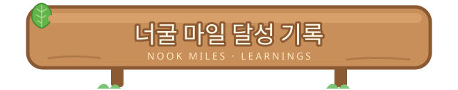

 

<table align="center">
  <tr>
    <td align="center">🧱</td><td><b>바닥부터 쌓기 마일</b></td><td>C로 표준 라이브러리를 직접 다시 만들며 메모리·포인터를 몸으로 익혔어요</td>
  </tr>
  <tr>
    <td align="center">🏗️</td><td><b>3층 집 건축 마일</b></td><td>Spring Boot · FastAPI · React를 역할별로 나눠 하나의 서비스로 엮었어요</td>
  </tr>
  <tr>
    <td align="center">🤖</td><td><b>AI 조수 고용 마일</b></td><td>Claude API로 문서 필드 추출·적격 판단을, SBERT로 시맨틱 검색을 구현했어요</td>
  </tr>
  <tr>
    <td align="center">🌱</td><td><b>텃밭 지킴이 마일</b></td><td>센서 → MQTT → 클라우드 → 대시보드까지 IoT 파이프라인을 끝까지 연결했어요</td>
  </tr>
  <tr>
    <td align="center">💬</td><td><b>수다쟁이 주민 마일</b></td><td>STOMP/WebSocket 실시간 채팅과 WebRTC 화상회의를 붙여 봤어요</td>
  </tr>
  <tr>
    <td align="center">🗺️</td><td><b>지도 탐험가 마일</b></td><td>PostGIS 공간 쿼리, Google Maps · 카카오맵 위에 데이터를 그려 봤어요</td>
  </tr>
  <tr>
    <td align="center">🚁</td><td><b>하늘 개척 마일</b></td><td>얼굴·손동작 인식으로 드론을 움직이고, 그걸로 수업까지 했어요</td>
  </tr>
  <tr>
    <td align="center">⛄</td><td><b>벨 발행 마일</b></td><td>ERC-20 / ERC-1155 토큰과 아이템 판매 컨트랙트를 작성했어요</td>
  </tr>
</table>

 

<!-- ───────────────────────── K.K. 라이브 ───────────────────────── -->

  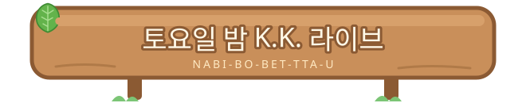
    
  
   
  🎸 빌드가 한 번에 성공하면 저도 모르게 흥얼거려요 — <i>나비보벳따우~ ♪</i>

 

<!-- ───────────────────────── 섬 소식 ───────────────────────── -->

  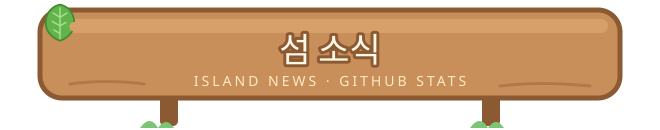
    
  
  
   
  

 

  
   
  🍃 <b>미르</b> : "편지는 언제든 환영이에요! 우편함 확인하러 갈게요~" 📮


🍃 이 README는 『모여봐요 동물의 숲』을 좋아하는 마음으로 만든 팬 오마주입니다. 헤더 · 푸터 · 주민 캐릭터 · GIF는 이 README를 위해 직접 그렸어요.

